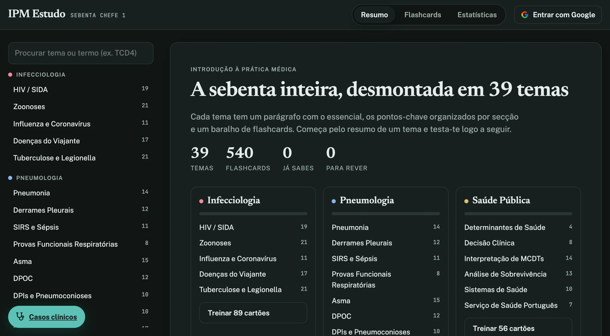
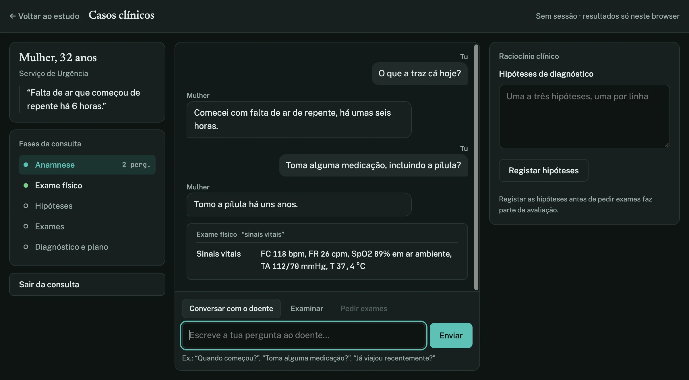
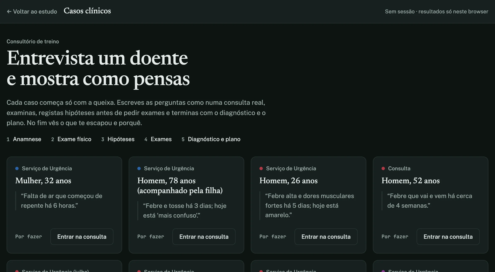
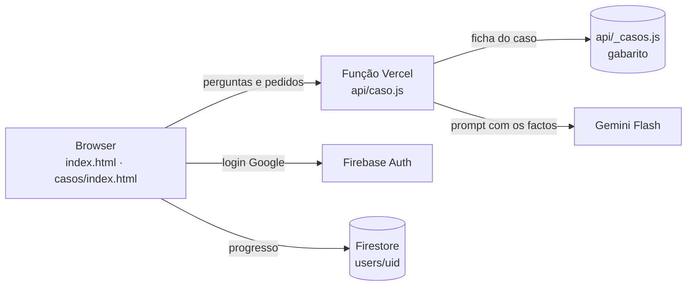

# IPM Estudo

**A sebenta de Introdução à Prática Médica, desmontada em 39 temas, 540 flashcards e 10 doentes virtuais que podes entrevistar.**

[ipm-estudo.vercel.app](https://ipm-estudo.vercel.app)



Estudar a partir de um PDF de 431 páginas é lento. Este site parte-o em pedaços que se conseguem rever num intervalo entre aulas e junta o que falta à sebenta: praticar a consulta.

## O que tem

### Resumo e flashcards
- **39 temas** em cinco áreas: Infecciologia, Pneumologia, Saúde Pública, Cardiovascular, e Sintomas e Semiologia.
- Cada tema tem um parágrafo com o essencial, os pontos-chave por secção e um baralho de flashcards.
- Marcas o que já sabes e o que é para rever. As estatísticas mostram o que falta por área e uma estimativa da probabilidade de passar.
- Pesquisa por tema ou termo, por exemplo `TCD4`.
- O PDF original, um resumo para imprimir e o modelo de história clínica estão a um clique.

### Casos clínicos
Cada caso começa só com a queixa principal. O resto descobres tu, como numa consulta.



1. **Anamnese.** Escreves as perguntas em texto livre e o doente responde como um leigo, em português de Portugal.
2. **Exame físico.** Pedes o que queres examinar e recebes os achados da ficha do caso.
3. **Hipóteses.** Registas até três hipóteses *antes* de poderes pedir exames.
4. **Exames.** Pedes os exames complementares. Os que não têm indicação descontam.
5. **Diagnóstico e plano.** No fim recebes uma nota de 0 a 20, o que te escapou e porquê, e a história clínica montada a partir da tua consulta.

| Caso | Área |
| --- | --- |
| Tromboembolismo pulmonar | Pneumologia |
| Pneumonia adquirida na comunidade grave | Pneumologia |
| Tuberculose pulmonar ativa | Infecciologia |
| Pneumocistose em doente com VIH | Infecciologia |
| Leptospirose grave (doença de Weil) | Infecciologia |
| Brucelose | Infecciologia |
| Febre escaro-nodular | Infecciologia |
| Malária grave por *P. falciparum* | Infecciologia |
| Síncope por estenose aórtica | Cardiovascular |
| Hiperaldosteronismo primário | Cardiovascular |



## Como o doente virtual não inventa

Um simulador com IA só serve para estudar se não alucinar achados. Por isso, a IA tem dois papéis limitados:

- **Na anamnese**, o modelo (Gemini) faz de doente, mas só pode usar os factos da ficha do caso. Se a pergunta não estiver coberta, responde como alguém que não tem esse problema. Nunca revela o diagnóstico.
- **No exame físico e nos exames**, o modelo só *identifica* o que pediste. Os achados vêm sempre, palavra por palavra, da ficha do caso.

As perguntas, as manobras de exame e os exames disponíveis são iguais em todos os casos, para que a lista não denuncie o que interessa. O gabarito fica só no servidor.

### Como a nota é calculada

A maior parte da nota é calculada por código, com pesos fixos por caso. A IA só avalia o texto livre do diagnóstico e do plano.

| Dimensão | Peso | Como se mede |
| --- | --- | --- |
| Anamnese | 30% | Perguntas-chave feitas, ponderadas por importância |
| Exame físico | 20% | Manobras-chave feitas |
| Hipóteses | 10% | Se o diagnóstico principal estava nas hipóteses |
| Exames | 15% | Exames indicados pedidos, menos os errados ou sem indicação |
| Diagnóstico | 15% | Avaliado pela IA, aceita sinónimos |
| Plano | 10% | Avaliado pela IA: elementos essenciais e nada contraindicado |

## Arquitetura



- **Front-end:** HTML, CSS e JavaScript sem frameworks nem build. Cada página é um ficheiro.
- **API:** uma função serverless no Vercel (`api/caso.js`) que guarda a chave do Gemini e o gabarito dos casos. O modelo escolhido tem alternativas automáticas se estiver sobrecarregado.
- **Conta (opcional):** login com Google via Firebase. Sem sessão, o progresso fica no `localStorage`. As regras do Firestore (`firestore.rules`) só deixam cada pessoa ler e escrever o seu próprio documento.

```
.
├── index.html            resumo, flashcards e estatísticas
├── casos/index.html      simulador de casos clínicos
├── api/
│   ├── caso.js           função Vercel: doente simulado e avaliação
│   └── _casos.js         fichas dos 10 casos e banco comum de perguntas
├── firebase-config.js    configuração pública do Firebase
├── firestore.rules       regras de acesso ao Firestore
└── docs/                 imagens deste README
```

## Correr localmente

Precisas de Node 18 ou mais recente e da [CLI do Vercel](https://vercel.com/docs/cli).

```bash
git clone https://github.com/DinisMiranda/ipm-estudo
cd ipm-estudo
echo "GEMINI_API_KEY=a-tua-chave" > .env.local
vercel dev
```

A página de estudo funciona sem chave. Os casos clínicos precisam de `GEMINI_API_KEY`, e uma chave gratuita do [Google AI Studio](https://aistudio.google.com/apikey) chega.

| Variável | Obrigatória | Para quê |
| --- | --- | --- |
| `GEMINI_API_KEY` | Sim, para os casos | Chave da API do Gemini |
| `GEMINI_MODEL` | Não | Força um modelo específico em vez da escolha automática |

## Aviso

Este é um projeto de estudo feito por um estudante. Não substitui a sebenta, as aulas nem o juízo clínico, e não deve ser usado para decisões sobre doentes reais.

## Créditos

- Conteúdo baseado na *Sebenta Chefe* de Introdução à Prática Médica.
- Interface dos casos clínicos polida com [unslop](https://github.com/heydamir/unslop), de Damir Sokolovsky (CC BY 4.0).
